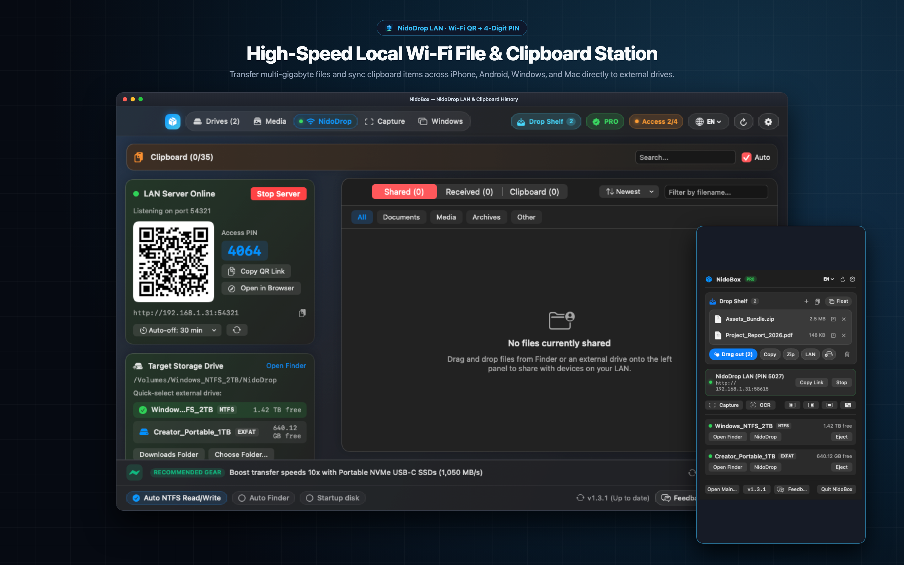
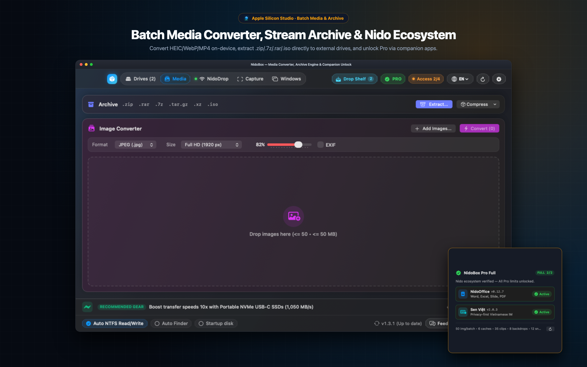

<p align="center">
  
</p>

<p align="center">
  <strong>English</strong> · <a href="docs/README.vi.md">Tiếng Việt</a> · <a href="docs/README.ja.md">日本語</a> · <a href="docs/README.ko.md">한국어</a> · <a href="docs/README.zh.md">简体中文</a> · <a href="docs/README.th.md">ไทย</a> · <a href="docs/README.id.md">Indonesia</a> · <a href="docs/README.de.md">Deutsch</a> · <a href="docs/README.es.md">Español</a> · <a href="docs/README.it.md">Italiano</a> · <a href="docs/README.pt.md">Português</a>
</p>

# NidoBox — NTFS Read/Write, NidoDrop LAN & Native Desktop Utility Suite (macOS & Windows)

[](https://github.com/stevedat/nidobox-releases/releases/latest)
[](https://github.com/stevedat/nidobox-releases/releases/latest)
[](https://github.com/stevedat/nidobox-releases/releases/latest)
[](https://tools.nido-holdings.com)

**NidoBox** *(formerly NidoNTFS)* is a fast native desktop utility suite for **macOS 13.0+** (SwiftUI) and **Windows 10/11** (Rust + Tauri 2.0 + WebGPU), built as dedicated single-architecture packages with zero emulation overhead.

## Downloads

| Platform & Silicon | Installer (`v1.4.0`) | Included Capabilities |
| :--- | :--- | :--- |
| **macOS Apple Silicon (`arm64`)** · M1–M4 | [**NidoBox-mac-arm64.dmg**](https://github.com/stevedat/nidobox-releases/releases/latest/download/NidoBox-mac-arm64.dmg) | Full Mac Suite: NTFS R/W, NidoDrop LAN, Archive, Cleaner, Media, Capture + OCR, Record, Snap, Shelf (`9.7 MB`) |
| **macOS Intel (`x86_64`)** | [**NidoBox-mac-x64.dmg**](https://github.com/stevedat/nidobox-releases/releases/latest/download/NidoBox-mac-x64.dmg) | Mac Core Edition: NTFS R/W, S.M.A.R.T. Health, NidoDrop LAN (`9.0 MB`) |
| **Windows 10/11 x64 (`x86_64`)** · Intel & AMD | [**NidoBox-win-x64.exe**](https://github.com/stevedat/nidobox-releases/releases/latest/download/NidoBox-win-x64.exe) | Windows x64 Native: Capture Studio (WebGPU + Callouts + OCR), NidoDrop LAN, Batch Image, Archive, Auto-Startup (`2.9 MB`) |
| **Windows 11 ARM64 (`aarch64`)** · Snapdragon X | [**NidoBox-win-arm64.exe**](https://github.com/stevedat/nidobox-releases/releases/latest/download/NidoBox-win-arm64.exe) | Windows ARM64 Native (Snapdragon X / Copilot+): Full Windows Suite, zero x64 emulation (`2.6 MB`) |

## Core Capabilities

- **Kextless NTFS Read/Write (`macOS arm64 & x86_64`):** User-space `NTFS-3G` + `FUSE-T` mount in `/Volumes` without disabling SIP, S.M.A.R.T. health, and sleep/wake safe flush.
- **High-Speed NidoDrop LAN (`macOS & Windows`):** Local Wi-Fi file and clipboard transfer via QR + 4-digit PIN with `TCP_NODELAY` streaming and resumable Range downloads.
- **Mac Studio Suite (`macOS arm64`):** Archive (`.zip`/`.7z`/`.rar`/`.iso`), Disk Cleaner, Batch Media Converter, Smart Screenshot Markup (Cinema Spotlight, Redact, Curved Callouts, AI Auto-Shield, on-demand OCR), Quick Record Studio (Filmstrip Trimmer, MP4/GIF), Window Snap, and Drop Shelf.
- **Windows Native Edition (`win-x64 & win-arm64`):** Ultra-light ~3 MB Rust + WebGPU studio with Capture Markup, S-curve Callout notes, Sensitive Auto-Shield, on-demand `Windows.Media.Ocr`, parallel Batch Image converter, Zip-Slip-guarded Archive engine, and silent Tray auto-startup.

## Interface

| NTFS Read/Write & Drop Shelf HUD | NidoDrop LAN QR Transfer |
| :---: | :---: |
|  |  |
| **Smart Screenshot Markup & Auto-Shield** | **Quick Record Studio & Video Trimmer** |
|  |  |
| **Auto-Updater & System Settings** | **Batch Media, Archive & Companion Apps** |
|  |  |

## Architecture

<p align="center">
  
</p>

## Verify Checksums

```bash
# macOS / Linux
shasum -a 256 -c SHA256SUMS.txt
# Windows PowerShell
Get-FileHash .\NidoBox-win-*.exe -Algorithm SHA256
```
