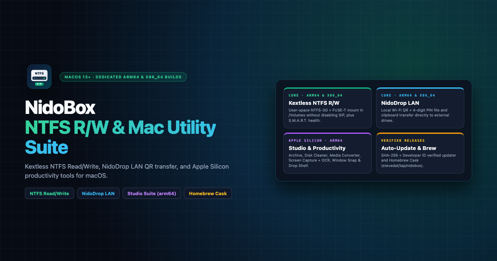
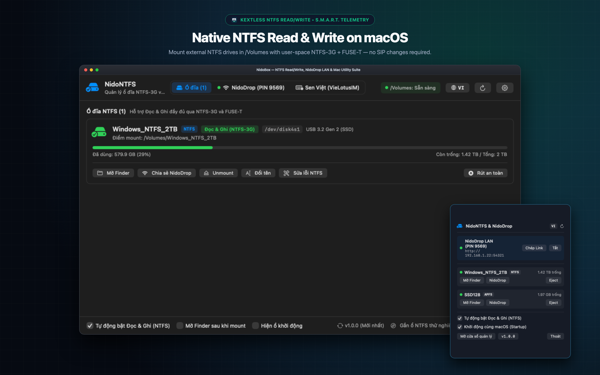
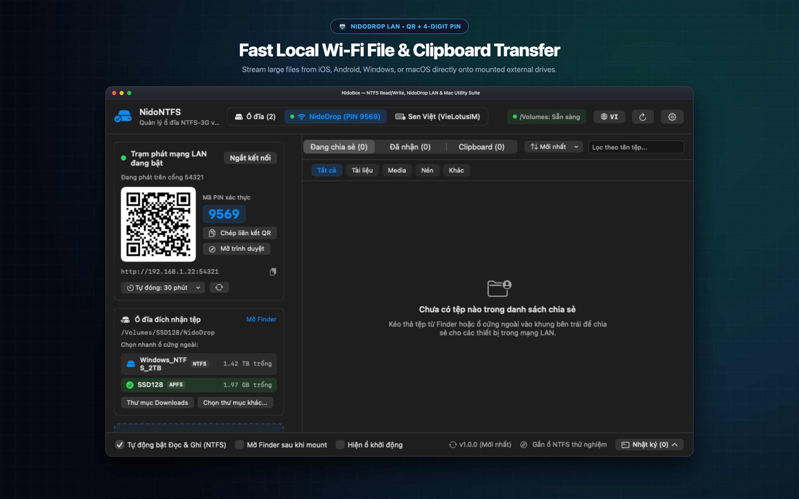
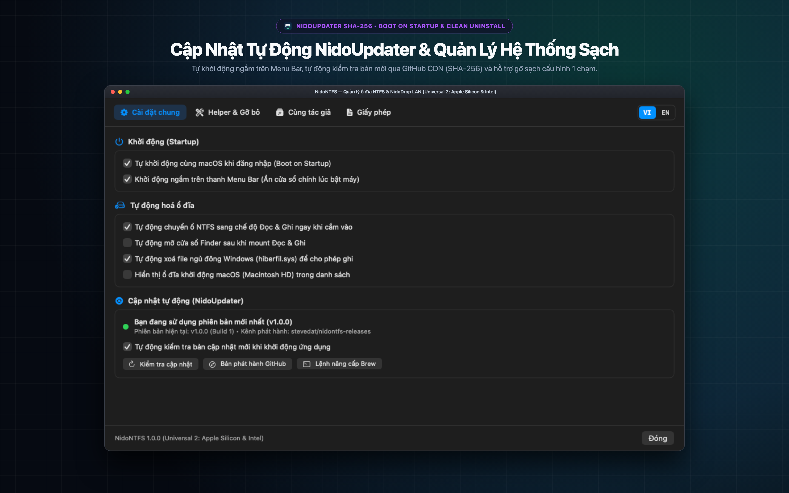
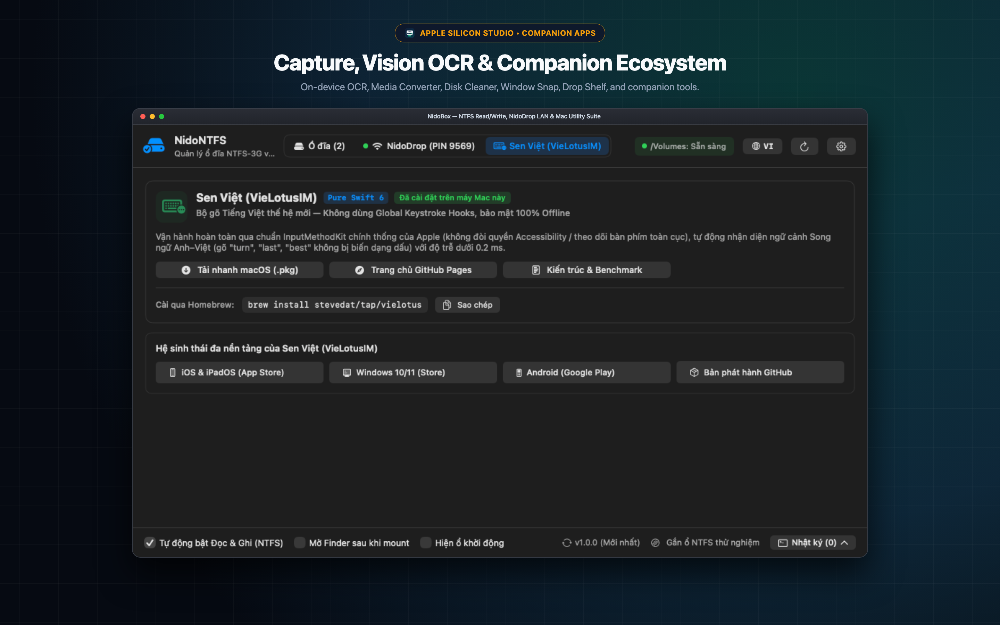
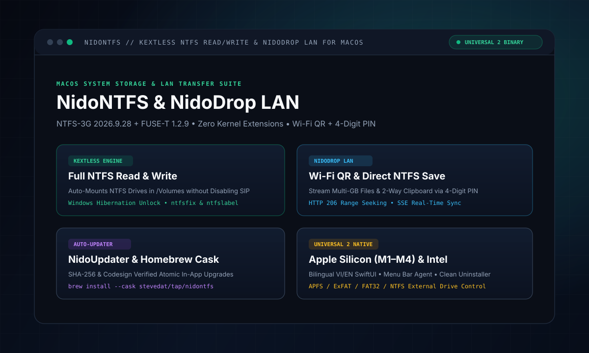

<p align="center">
  
</p>

<p align="center">
  **[🇺🇸 English](README.md)** · [🇻🇳 Tiếng Việt](docs/README.vi.md) · [🇹🇭 ภาษาไทย](docs/README.th.md) · [🇯🇵 日本語](docs/README.ja.md) · [🇰🇷 한국어](docs/README.ko.md) · [🇨🇳 简体中文](docs/README.zh.md) · [🇮🇩 Bahasa Indonesia](docs/README.id.md) · [🇩🇪 Deutsch](docs/README.de.md) · [🇮🇹 Italiano](docs/README.it.md) · [🇪🇸 Español](docs/README.es.md) · [🇵🇹 Português](docs/README.pt.md)
</p>

# NidoNTFS — Native NTFS Read/Write, S.M.A.R.T. Drive Health, Adaptive USB/SSD I/O & NidoDrop LAN for macOS

[](https://github.com/stevedat/nidontfs-releases/releases/latest)
[](https://github.com/stevedat/homebrew-tap)
[-38bdf8?style=flat-square&logo=apple)](https://github.com/stevedat/nidontfs-releases/releases/latest)
[](https://github.com/stevedat/nidontfs-releases/releases/latest)
[](https://tools.nido-holdings.com)

**NidoNTFS** is a native SwiftUI Universal 2 (`arm64` + `x86_64`) system utility for **macOS 13.0+ (Ventura, Sonoma, Sequoia, Tahoe)**. It combines kernel-extension-free **NTFS Read/Write (`NTFS-3G 2026.9.28` + `FUSE-T 1.2.9`)**, real-time **S.M.A.R.T. & Drive Health diagnostics**, direct-to-drive archive streaming (**`NidoArchive` — `libarchive 3.7.4`**), **NidoDrop LAN** file/clipboard transfer, and **NidoUpdater**.

---

## 📦 Direct Downloads

Evergreen links always point to the latest official notarized release (`v1.2.2`):

| Platform | Architecture | Direct Installer | Format |
| :--- | :--- | :--- | :--- |
| **macOS Universal 2 (Evergreen DMG)** | `arm64` (M1–M4) & `x86_64` (Intel) | [**NidoNTFS-mac-universal.dmg**](https://github.com/stevedat/nidontfs-releases/releases/latest/download/NidoNTFS-mac-universal.dmg) | Standard Drag-and-Drop Installer (`16.1 MB`) |
| **macOS Apple Silicon (`arm64`)** | `arm64` (M1 / M2 / M3 / M4) | [**NidoNTFS-mac-arm64.dmg**](https://github.com/stevedat/nidontfs-releases/releases/latest/download/NidoNTFS-mac-arm64.dmg) | Apple Silicon M1–M4 Installer (`16.1 MB`) |
| **macOS Intel (`x86_64`)** | `x86_64` (Intel Mac) | [**NidoNTFS-mac-x64.dmg**](https://github.com/stevedat/nidontfs-releases/releases/latest/download/NidoNTFS-mac-x64.dmg) | Intel Mac Installer (`16.1 MB`) |
| **macOS Universal 2 (`v1.2.2` DMG)** | `arm64` & `x86_64` | [**NidoNTFS-1.2.2-universal.dmg**](https://github.com/stevedat/nidontfs-releases/releases/download/v1.2.2/NidoNTFS-1.2.2-universal.dmg) | Standard Drag-and-Drop Installer (`16.1 MB`) |
| **macOS Universal 2 (Portable ZIP)** | `arm64` & `x86_64` | [**NidoNTFS-mac-universal.zip**](https://github.com/stevedat/nidontfs-releases/releases/latest/download/NidoNTFS-mac-universal.zip) | Portable `.app` Bundle (`14.9 MB`) |

---

## ⚡ Install & Upgrade via Homebrew

```bash
brew install --cask stevedat/tap/nidontfs
```

```bash
brew update && brew upgrade --cask nidontfs
```

---

## ✨ Key Highlights

- **Zero-Kext NTFS Read/Write & Sleep/Wake Resilience:** Powered by `NTFS-3G` + `FUSE-T` (loopback NFSv4) with non-blocking `MNT_NOWAIT` kernel mount inspection, automatic pre-sleep buffer flush (`sync`), and instant stale-mount cleanup so unplugging or sleeping never hangs Finder.
- **Real-Time Drive Health & S.M.A.R.T. Telemetry:** Displays S.M.A.R.T. verification status, SSD life remaining (`%`), hardware temperature (`°C`), Total Bytes Written/Read (`TBW/TBR`), physical USB link speed (`5–10 Gbps SuperSpeed` vs `480 Mbps USB 2.0` bottleneck warnings), and active I/O profile.
- **Adaptive Media I/O Engine:** Automatically selects `4 MB` I/O frames for NVMe/SATA SSDs, `2 MB` for HDDs, and `512 KB` for USB Flash & SD Cards — eliminating Finder `Error -36` and NAND cache stalls.
- **NidoArchive Direct Streaming (`libarchive 3.7.4`):** Extract `.zip`, `.7z`, `.rar`, `.tar.gz`, `.xz`, `.iso` directly onto external drives with 1 MB write-coalescing and zero temporary SSD space.
- **NidoDrop LAN Station:** Transfer large files and sync 2-way Smart Clipboard across macOS, iOS, Android, and Windows over local Wi-Fi/LAN via QR Code & 4-digit PIN.

---

## 🌐 Instant Multi-Language Overview (11 Supported Languages)

<details>
<summary><strong>🇻🇳 Tiếng Việt</strong> — Đọc/Ghi NTFS Nguyên Bản, Sức Khoẻ Ổ Đĩa S.M.A.R.T., Tối Ưu I/O USB/SSD & NidoDrop LAN cho macOS (<a href="docs/README.vi.md">Full README →</a>)</summary>

**NidoNTFS** là bộ công cụ hệ thống gốc (**Native SwiftUI Universal 2: `arm64` + `x86_64`**) dành cho **macOS 13.0+ (Ventura, Sonoma, Sequoia, Tahoe)**, kết hợp trình quản lý **Đọc & Ghi NTFS không cần kext (`NTFS-3G 2026.9.28` + `FUSE-T 1.2.9`)**, theo dõi **Sức khoẻ ổ đĩa S.M.A.R.T.**, giải nén luồng trực tiếp **NidoArchive (`libarchive 3.7.4`)**, trạm truyền tệp nội bộ **NidoDrop LAN** và **NidoUpdater**.

  - **Đọc/Ghi NTFS Không Cần Kext & Chống Treo Máy Khi Sleep/Wake:** Vận hành trên `NTFS-3G` + `FUSE-T` kết hợp truy vấn bảng mount `MNT_NOWAIT` không chặn nhân, tự động xả đệm (`sync`) trước khi máy ngủ và dọn dẹp tức thì điểm mount ngắt kết nối.
  - **Hiển Thị Sức Khoẻ Ổ Đĩa & S.M.A.R.T. Trực Quan:** Theo dõi trạng thái S.M.A.R.T., tuổi thọ chip nhớ còn lại (`%`), nhiệt độ (`°C`), tổng dữ liệu Đọc/Ghi (`TBW/TBR`), tốc độ cổng USB vật lý (cảnh báo khi cắm SSD vào cáp/cổng `USB 2.0 480 Mbps`) và cấu hình I/O.
  - **Bộ Máy I/O Thích Ứng Đa Thiết Bị:** Tự động phân bổ khung truyền `4 MB` cho SSD, `2 MB` cho HDD và `512 KB` cho USB Flash / Thẻ nhớ SD — triệt tiêu lỗi Finder `Error -36`.
  - **Giải Nén Luồng Trực Tiếp (`NidoArchive` — `libarchive 3.7.4`):** Giải nén thẳng `.zip`, `.7z`, `.rar`, `.tar.gz`, `.xz`, `.iso` vào ổ đĩa ngoài với bộ đệm gộp 1 MB, không tốn dung lượng tạm trên ổ trong.
  - **Trạm Truyền Tệp Nội Bộ NidoDrop LAN:** Truyền tệp dung lượng lớn và đồng bộ Clipboard 2 chiều giữa macOS, iOS, Android, Windows qua Wi-Fi/LAN bằng mã QR & PIN 4 số.
</details>
<details>
<summary><strong>🇹🇭 ภาษาไทย</strong> — อ่าน/เขียน NTFS เนทีฟ, ตรวจสอบสุขภาพดิสก์ S.M.A.R.T., ปรับแต่ง I/O USB/SSD และ NidoDrop LAN สำหรับ macOS (<a href="docs/README.th.md">Full README →</a>)</summary>

**NidoNTFS** คือยูทิลิตี้ระบบเนทีฟ SwiftUI Universal 2 (`arm64` + `x86_64`) สำหรับ **macOS 13.0+**. รองรับการอ่าน/เขียน NTFS โดยไม่ต้องใช้ kext (`NTFS-3G` + `FUSE-T`), การตรวจสอบสุขภาพดิสก์ S.M.A.R.T., การแตกไฟล์ตรงลงดิสก์ (`NidoArchive`) และการแชร์ไฟล์ผ่าน LAN (`NidoDrop`).

  - **อ่าน/เขียน NTFS ความเร็วสูงและเสถียรเมื่อ Sleep/Wake:** ใช้ `MNT_NOWAIT` ป้องกันอาการค้างของ Finder เมื่อถอดสาย USB หรือพับหน้าจอ.
  - **ตรวจสอบสุขภาพดิสก์ S.M.A.R.T.:** แสดงสถานะ S.M.A.R.T., อายุการใช้งาน SSD (`%`), อุณหภูมิ (`°C`), และความเร็วพอร์ต USB (`5–10 Gbps` vs `USB 2.0`).
  - **Adaptive I/O Engine:** ปรับขนาดบัฟเฟอร์อัตโนมัติ (`4 MB` สำหรับ SSD, `2 MB` สำหรับ HDD, `512 KB` สำหรับ USB Flash / SD Card).
  - **NidoArchive & NidoDrop LAN:** แตกไฟล์ `.zip`, `.7z`, `.rar`, `.iso` ลงดิสก์โดยตรง และส่งไฟล์ข้ามอุปกรณ์ผ่าน Wi-Fi LAN ด้วย QR Code.
</details>
<details>
<summary><strong>🇯🇵 日本語</strong> — macOS向けネイティブNTFS読み書き・S.M.A.R.T.健康診断・USB/SSD高速I/O & NidoDrop LAN (<a href="docs/README.ja.md">Full README →</a>)</summary>

**NidoNTFS** は **macOS 13.0+** 対応のネイティブ SwiftUI Universal 2 (`arm64` + `x86_64`) システムユーティリティです。カーネル拡張不要の **NTFS 読み書き (`NTFS-3G` + `FUSE-T`)**、**S.M.A.R.T. ドライブ健康診断**、直接展開エンジン **`NidoArchive`**、LANファイル共有 **`NidoDrop`** を統合しています。

  - **カーネル拡張不要のNTFS読み書き & スリープ復帰保護:** 非ブロッキング `MNT_NOWAIT` 監視とスリープ前の自動フラッシュにより、Finderのフリーズを完全に防止します。
  - **リアルタイム S.M.A.R.T. & ドライブ健康状態表示:** S.M.A.R.T. 検証状態、SSD残寿命 (`%`)、温度 (`°C`)、総書込量 (`TBW`)、USBリンク速度 (`SuperSpeed` vs `USB 2.0` 警告) を表示。
  - **メディア適応型 I/O エンジン:** SSD (`4 MB`)、HDD (`2 MB`)、USBメモリ/SDカード (`512 KB`) に合わせて転送フレームを自動最適化。
  - **NidoArchive & NidoDrop LAN:** `.zip` / `.7z` / `.rar` / `.iso` の直接ストリーム展開と、QRコードによる高速LANファイル＆クリップボード共有。
</details>
<details>
<summary><strong>🇰🇷 한국어</strong> — macOS용 네이티브 NTFS 읽기/쓰기, S.M.A.R.T. 디스크 건강 상태, 적응형 USB/SSD I/O 및 NidoDrop LAN (<a href="docs/README.ko.md">Full README →</a>)</summary>

**NidoNTFS**는 **macOS 13.0+**용 네이티브 SwiftUI Universal 2 (`arm64` + `x86_64`) 유틸리티입니다. 커널 확장 없는 **NTFS 읽기/쓰기 (`NTFS-3G` + `FUSE-T`)**, 실시간 **S.M.A.R.T. 디스크 건강 진단**, **`NidoArchive`** 스트림 압축 해제 및 **`NidoDrop LAN`** 파일 전송을 제공합니다.

  - **안전한 NTFS 읽기/쓰기 및 잠자기/깨우기 연속성:** 비차단 `MNT_NOWAIT` 마운트 검사 및 절전 전 자동 버퍼 플러시(`sync`)로 Finder 멈춤 현상을 원천 방지합니다.
  - **실시간 S.M.A.R.T. 및 드라이브 건강 상태:** S.M.A.R.T. 상태, SSD 잔여 수명(`%`), 온도(`°C`), 총 쓰기/읽기 용량(`TBW/TBR`), USB 연결 속도(`5–10 Gbps` vs `USB 2.0` 병목 경고) 표시.
  - **적응형 I/O 엔진:** SSD(`4 MB`), HDD(`2 MB`), USB 플래시/SD 카드(`512 KB`)별 최적의 전송 블록 크기를 자동 적용하여 Finder `Error -36` 방지.
  - **NidoArchive & NidoDrop LAN:** 외장 드라이브 직접 압축 해제 및 QR 코드 기반 로컬 Wi-Fi/LAN 고속 파일·클립보드 공유.
</details>
<details>
<summary><strong>🇨🇳 简体中文</strong> — macOS 原生 NTFS 读写、S.M.A.R.T. 磁盘健康检测、自适应 USB/SSD I/O 与 NidoDrop 局域网快传 (<a href="docs/README.zh.md">Full README →</a>)</summary>

**NidoNTFS** 是一款专为 **macOS 13.0+** 打造的原生 SwiftUI Universal 2 (`arm64` + `x86_64`) 系统工具，集成免内核扩展 **NTFS 读写 (`NTFS-3G` + `FUSE-T`)**、**S.M.A.R.T. 磁盘健康监测**、**`NidoArchive`** 流式解压以及 **`NidoDrop LAN`** 局域网传输。

  - **免内核扩展 NTFS 读写与休眠唤醒保护：** 采用非阻塞 `MNT_NOWAIT` 挂载表检测与休眠前自动刷盘 (`sync`)，彻底杜绝拔出 U 盘或合盖休眠导致的 Finder 卡死与重启。
  - **实时 S.M.A.R.T. 与磁盘健康面板：** 直观显示 S.M.A.R.T. 状态、SSD 剩余寿命 (`%`)、温度 (`°C`)、累计读写量 (`TBW/TBR`) 及物理 USB 速率（自动提醒 `USB 2.0` 线材瓶颈）。
  - **自适应存储介质 I/O 引擎：** 针对 SSD (`4 MB`)、HDD (`2 MB`) 与 U 盘/SD 卡 (`512 KB`) 自动调整传输窗口，彻底消除 Finder `Error -36`。
  - **NidoArchive 流式解压与 NidoDrop 局域网快传：** 支持 `.zip` / `.7z` / `.rar` / `.iso` 直解外置硬盘，并通过二维码在 Mac、手机与 PC 间高速互传文件与剪贴板。
</details>
<details>
<summary><strong>🇮🇩 Bahasa Indonesia</strong> — Baca/Tulis NTFS Native, Kesehatan Disk S.M.A.R.T., I/O Adaptif USB/SSD & NidoDrop LAN untuk macOS (<a href="docs/README.id.md">Full README →</a>)</summary>

**NidoNTFS** adalah utilitas sistem SwiftUI Universal 2 (`arm64` + `x86_64`) native untuk **macOS 13.0+**, menggabungkan **Baca/Tulis NTFS tanpa kext (`NTFS-3G` + `FUSE-T`)**, pemantauan **Kesehatan Disk S.M.A.R.T.**, ekstraksi arsip **`NidoArchive`**, dan berbagi file **`NidoDrop LAN`**.

  - **Baca/Tulis NTFS Stabil & Tahan Sleep/Wake:** Menggunakan pemeriksaan mount non-blocking `MNT_NOWAIT` dan flush otomatis sebelum sleep agar Finder tidak pernah macet.
  - **Diagnostik Kesehatan Disk & S.M.A.R.T.:** Menampilkan status S.M.A.R.T., sisa umur SSD (`%`), suhu (`°C`), total baca/tulis (`TBW/TBR`), serta kecepatan port USB.
  - **Mesin I/O Adaptif:** Mengatur jendela transfer otomatis (`4 MB` SSD, `2 MB` HDD, `512 KB` USB Flash / SD Card) bebas `Error -36`.
  - **NidoArchive & NidoDrop LAN:** Ekstrak `.zip`, `.7z`, `.rar`, `.iso` langsung ke drive eksternal dan kirim file via Wi-Fi LAN dengan QR Code.
</details>
<details>
<summary><strong>🇩🇪 Deutsch</strong> — Natives NTFS Lesen/Schreiben, S.M.A.R.T.-Laufwerksstatus, Adaptives USB/SSD-I/O & NidoDrop LAN für macOS (<a href="docs/README.de.md">Full README →</a>)</summary>

**NidoNTFS** ist ein natives SwiftUI Universal 2 (`arm64` + `x86_64`) Systemprogramm für **macOS 13.0+**. Es vereint **NTFS-Lese-/Schreibzugriff ohne Kernel-Extension (`NTFS-3G` + `FUSE-T`)**, **S.M.A.R.T.-Gesundheitsdiagnose**, **`NidoArchive`** Direkt-Entpacken und **`NidoDrop LAN`** Dateiübertragung.

  - **Stabiles NTFS Lesen/Schreiben & Ruhezustand-Schutz:** Blockierungsfreie `MNT_NOWAIT`-Prüfung und automatischer Buffer-Flush (`sync`) vor dem Ruhezustand verhindern Finder-Hänger.
  - **S.M.A.R.T. & Laufwerksgesundheit in Echtzeit:** Zeigt S.M.A.R.T.-Status, verbleibende SSD-Lebensdauer (`%`), Temperatur (`°C`), `TBW/TBR` und USB-Verbindungsgeschwindigkeit.
  - **Adaptive I/O-Engine:** Optimiert die Puffergröße automatisch (`4 MB` SSD, `2 MB` HDD, `512 KB` USB-Stick / SD-Karte) gegen Finder `Error -36`.
  - **NidoArchive & NidoDrop LAN:** Direktes Entpacken von `.zip`, `.7z`, `.rar`, `.iso` sowie schneller LAN-Dateiaustausch per QR-Code.
</details>
<details>
<summary><strong>🇮🇹 Italiano</strong> — Lettura/Scrittura NTFS Nativa, Salute Disco S.M.A.R.T., I/O Adattivo USB/SSD & NidoDrop LAN per macOS (<a href="docs/README.it.md">Full README →</a>)</summary>

**NidoNTFS** è un'utility di sistema nativa SwiftUI Universal 2 (`arm64` + `x86_64`) per **macOS 13.0+** con **Lettura/Scrittura NTFS senza kext (`NTFS-3G` + `FUSE-T`)**, diagnostica **S.M.A.R.T.**, estrazione diretta **`NidoArchive`** e condivisione **`NidoDrop LAN`**.

  - **Lettura/Scrittura NTFS Sicura e Protezione Sleep/Wake:** Ispezione mount `MNT_NOWAIT` non bloccante e flush automatico prima dello stop per evitare blocchi del Finder.
  - **Stato di Salute Disco & S.M.A.R.T.:** Mostra stato S.M.A.R.T., vita residua SSD (`%`), temperatura (`°C`), `TBW/TBR` e velocità di collegamento USB.
  - **Motore I/O Adattivo:** Finestre di trasferimento di `4 MB` per SSD, `2 MB` per HDD e `512 KB` per chiavette USB e schede SD.
  - **NidoArchive & NidoDrop LAN:** Estrazione diretta `.zip`, `.7z`, `.rar`, `.iso` e trasferimento file/appunti via Wi-Fi LAN con QR Code.
</details>
<details>
<summary><strong>🇪🇸 Español</strong> — Lectura/Escritura NTFS Nativa, Salud S.M.A.R.T., E/S Adaptativa USB/SSD y NidoDrop LAN para macOS (<a href="docs/README.es.md">Full README →</a>)</summary>

**NidoNTFS** es una utilidad nativa SwiftUI Universal 2 (`arm64` + `x86_64`) para **macOS 13.0+** que integra **Lectura/Escritura NTFS sin kext (`NTFS-3G` + `FUSE-T`)**, diagnóstico de **Salud de Disco S.M.A.R.T.**, descompresión directa **`NidoArchive`** y transferencia **`NidoDrop LAN`**.

  - **Lectura/Escritura NTFS Estable y Protección en Reposo/Reanudación:** Consultas `MNT_NOWAIT` sin bloqueo y vaciado automático de caché antes de dormir para evitar cuelgues del Finder.
  - **Salud del Disco y Telemetría S.M.A.R.T.:** Muestra estado S.M.A.R.T., vida útil restante del SSD (`%`), temperatura (`°C`), `TBW/TBR` y velocidad del puerto USB.
  - **Motor de E/S Adaptativo:** Ajusta automáticamente bloques de `4 MB` (SSD), `2 MB` (HDD) y `512 KB` (USB Flash / Tarjeta SD) eliminando el `Error -36`.
  - **NidoArchive y NidoDrop LAN:** Extrae `.zip`, `.7z`, `.rar`, `.iso` directamente al disco externo y comparte archivos por Wi-Fi LAN mediante código QR.
</details>
<details>
<summary><strong>🇵🇹 Português</strong> — Leitura/Gravação NTFS Nativa, Saúde do Disco S.M.A.R.T., I/O Adaptativo USB/SSD e NidoDrop LAN para macOS (<a href="docs/README.pt.md">Full README →</a>)</summary>

**NidoNTFS** é um utilitário nativo SwiftUI Universal 2 (`arm64` + `x86_64`) para **macOS 13.0+** que reúne **Leitura/Gravação NTFS sem kext (`NTFS-3G` + `FUSE-T`)**, diagnóstico **S.M.A.R.T.**, extração direta **`NidoArchive`** e transferência **`NidoDrop LAN`**.

  - **Leitura/Gravação NTFS Estável e Proteção Sleep/Wake:** Verificação `MNT_NOWAIT` não bloqueante e descarga automática de buffer antes de dormir para evitar travamentos no Finder.
  - **Saúde do Disco & Telemetria S.M.A.R.T.:** Exibe status S.M.A.R.T., vida útil restante do SSD (`%`), temperatura (`°C`), `TBW/TBR` e velocidade da porta USB.
  - **Motor de I/O Adaptativo:** Configura automaticamente janelas de `4 MB` (SSD), `2 MB` (HDD) e `512 KB` (Pen Drive USB / Cartão SD) sem `Error -36`.
  - **NidoArchive & NidoDrop LAN:** Extraia `.zip`, `.7z`, `.rar`, `.iso` direto no disco externo e transfira arquivos via Wi-Fi LAN com QR Code.
</details>

---

## 🖥️ Native macOS Interface

| 1. NTFS, USB & SD Read/Write + S.M.A.R.T. Health | 2. NidoDrop LAN File & Clipboard Station |
| :---: | :---: |
|  |  |
| **3. NidoUpdater & 11-Language Engine** | **4. Companion Apps Ecosystem** |
|  |  |

---

## 🏛️ System Architecture

<p align="center">
  
</p>

---

## 🔐 SHA-256 Checksum Verification

```bash
shasum -a 256 -c SHA256SUMS.txt
```
