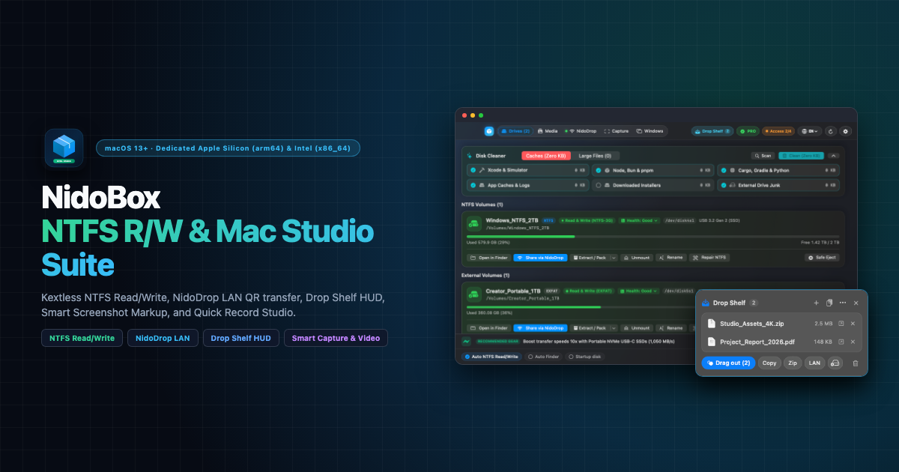

<p align="center">
  
</p>

<p align="center">
  <strong>English</strong> · <a href="docs/README.vi.md">Tiếng Việt</a> · <a href="docs/README.ja.md">日本語</a> · <a href="docs/README.ko.md">한국어</a> · <a href="docs/README.zh.md">简体中文</a> · <a href="docs/README.th.md">ไทย</a> · <a href="docs/README.id.md">Indonesia</a> · <a href="docs/README.de.md">Deutsch</a> · <a href="docs/README.es.md">Español</a> · <a href="docs/README.it.md">Italiano</a> · <a href="docs/README.pt.md">Português</a>
</p>

# NidoBox — NTFS Read/Write, NidoDrop LAN & Native Desktop Utility Suite (macOS, Windows & Linux)

[](https://github.com/stevedat/nidobox-releases/releases/latest)
[](https://github.com/stevedat/nidobox-releases/releases/latest)
[](https://github.com/stevedat/nidobox-releases/releases/latest)
[](https://github.com/stevedat/nidobox-releases/releases/latest)
[](https://tools.nido-holdings.com)

**NidoBox** is a fast native desktop utility suite for **macOS 13.0+** (SwiftUI), **Windows 10/11** (Rust + Tauri 2.0 + WebGPU), and **Linux** (GTK4/Libadwaita + static Rust musl), built as dedicated single-architecture packages with zero emulation overhead.

## Downloads

| Platform & Silicon | Installer (`v1.5.1`) | Included Capabilities |
| :--- | :--- | :--- |
| **macOS Apple Silicon (`arm64`)** · M1–M4 | [**NidoBox-mac-arm64.dmg**](https://github.com/stevedat/nidobox-releases/releases/latest/download/NidoBox-mac-arm64.dmg) | Full Mac Suite: NTFS R/W, NidoDrop LAN + Live View & Touch-back, NidoKVM, Archive, Cleaner, Media, Capture + OCR, Record, Snap, Shelf (`10.5 MB`) |
| **macOS Intel (`x86_64`)** | [**NidoBox-mac-x64.dmg**](https://github.com/stevedat/nidobox-releases/releases/latest/download/NidoBox-mac-x64.dmg) | Mac Core Edition: NTFS R/W, S.M.A.R.T. Health, NidoDrop LAN (`9.4 MB`) |
| **Windows 10/11 x64 (`x86_64`)** · Intel & AMD | [**NidoBox-win-x64.exe**](https://github.com/stevedat/nidobox-releases/releases/latest/download/NidoBox-win-x64.exe) | Windows x64 Native: NidoDrop LAN + Live View/Touch-back, NidoKVM, Capture Studio (WebGPU + OCR), Batch Image, Archive, Low-RAM Tray (`3.1 MB`) |
| **Windows 11 ARM64 (`aarch64`)** · Snapdragon X | [**NidoBox-win-arm64.exe**](https://github.com/stevedat/nidobox-releases/releases/latest/download/NidoBox-win-arm64.exe) | Windows ARM64 Native (Snapdragon X / Copilot+): Full Windows Suite, zero x64 emulation (`2.8 MB`) |
| **Linux x86_64 (`amd64`)** · Debian/Ubuntu/Fedora/Arch | [**.deb**](https://github.com/stevedat/nidobox-releases/releases/latest/download/nidobox_1.5.1_amd64.deb) · [**.rpm**](https://github.com/stevedat/nidobox-releases/releases/latest/download/nidobox-1.5.1-1.x86_64.rpm) · [**.pkg.tar.zst**](https://github.com/stevedat/nidobox-releases/releases/latest/download/nidobox-1.5.1-1-x86_64.pkg.tar.zst) · [**.tar.gz**](https://github.com/stevedat/nidobox-releases/releases/latest/download/nidobox-1.5.1-linux-x86_64.tar.gz) | Linux x86_64 (Debian/Ubuntu, Fedora/openSUSE, Arch, Portable): GTK4 + Static Rust, NidoDrop Live View & Touch-back, NidoKVM (Wayland/X11), Capture + OCR, NidoImage, NidoArchive, NTFS Repair |
| **Linux ARM64 (`aarch64`)** · Ubuntu-Nido/RPi/ARM | [**.deb**](https://github.com/stevedat/nidobox-releases/releases/latest/download/nidobox_1.5.1_arm64.deb) · [**.rpm**](https://github.com/stevedat/nidobox-releases/releases/latest/download/nidobox-1.5.1-1.aarch64.rpm) · [**.pkg.tar.zst**](https://github.com/stevedat/nidobox-releases/releases/latest/download/nidobox-1.5.1-1-aarch64.pkg.tar.zst) · [**.tar.gz**](https://github.com/stevedat/nidobox-releases/releases/latest/download/nidobox-1.5.1-linux-aarch64.tar.gz) | Linux ARM64 (Apple VM, Raspberry Pi, ARM Laptops): Native aarch64 static Rust + GTK4 suite |

### Linux APT Repository (Debian 12+ / Ubuntu 22.04+ / 24.04+ · `amd64` & `arm64`)

```bash
sudo install -d -m 0755 /etc/apt/keyrings
curl -fsSL https://ubuntu-nido-apt.pages.dev/ubuntu-nido.asc | sudo tee /etc/apt/keyrings/ubuntu-nido.asc >/dev/null
echo "deb [signed-by=/etc/apt/keyrings/ubuntu-nido.asc] https://ubuntu-nido-apt.pages.dev noble main" | sudo tee /etc/apt/sources.list.d/nidobox.list >/dev/null
sudo apt update && sudo apt install -y nidobox
```

## Core Capabilities

- **Kextless NTFS Read/Write (`macOS arm64 & x86_64`):** User-space `NTFS-3G` + `FUSE-T` mount in `/Volumes` without disabling SIP, S.M.A.R.T. health, and sleep/wake safe flush.
- **NidoDrop LAN + Live View & Touch-back (`macOS, Windows & Linux`):** High-speed Wi-Fi file/clipboard transfer via QR + 4-digit PIN, plus Live View Image Stage, Screen Cast (and Apple Silicon Virtual Extend Display), and remote Touch-back from phones/tablets via a unified Web Receiver.
- **Cross-OS NidoKVM (`macOS arm64, Windows & Linux`):** Seamless LAN mouse, keyboard, and clipboard sharing across macOS, Windows, and Linux (Wayland & X11) with edge switching, 4-digit PIN auth, and smart `Cmd ↔ Ctrl` mapping.
- **Mac Studio Suite (`macOS arm64`):** Archive (`.zip`/`.7z`/`.rar`/`.iso`), Disk Cleaner, Batch Media Converter, Smart Screenshot Markup (Cinema Spotlight, Redact, Curved Callouts, AI Auto-Shield, on-demand OCR), Quick Record Studio (Filmstrip Trimmer, MP4/GIF), Window Snap, and Drop Shelf.
- **Windows & Linux Native Editions (`x64 & ARM64`) + Ultra-Low RAM Engine:** ~3 MB Rust + WebGPU Windows app and GTK4/Libadwaita + static musl Linux suite with Kiri-inspired memory management: tray WebView2 teardown (~0 MB UI RAM when closed), compressed Capture Studio undo, 60s idle buffer sleep, and RAM-adaptive batch image workers.

## Interface

| NTFS Read/Write & Drop Shelf HUD | NidoDrop LAN QR Transfer |
| :---: | :---: |
|  |  |
| **Smart Screenshot Markup & Auto-Shield** | **Quick Record Studio & Video Trimmer** |
|  |  |
| **Auto-Updater & System Settings** | **Batch Media, Archive & Companion Apps** |
|  |  |

## Architecture

<p align="center">
  
</p>

## Verify Checksums

```bash
# macOS / Linux
shasum -a 256 -c SHA256SUMS.txt
# Windows PowerShell
Get-FileHash .\NidoBox-win-*.exe -Algorithm SHA256
```
