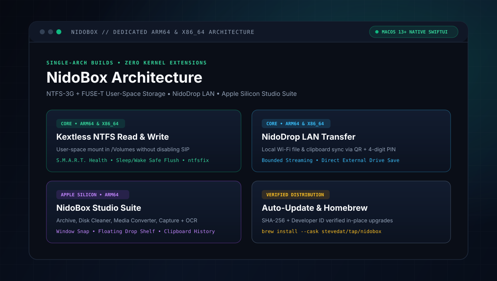

<p align="center">
  
</p>

<p align="center">
  <a href="../README.md">English</a> · <a href="README.vi.md">Tiếng Việt</a> · <a href="README.ja.md">日本語</a> · <a href="README.ko.md">한국어</a> · <a href="README.zh.md">简体中文</a> · <a href="README.th.md">ไทย</a> · <a href="README.id.md">Indonesia</a> · <strong>Deutsch</strong> · <a href="README.es.md">Español</a> · <a href="README.it.md">Italiano</a> · <a href="README.pt.md">Português</a>
</p>

# NidoBox — NTFS Lesen/Schreiben, NidoDrop LAN & macOS-Utility-Suite

[](https://github.com/stevedat/nidobox-releases/releases/latest)
[](https://github.com/stevedat/homebrew-tap)
[](https://github.com/stevedat/nidobox-releases/releases/latest)
[](https://github.com/stevedat/nidobox-releases/releases/latest)
[](https://tools.nido-holdings.com)

**NidoBox** *(ehemals NidoNTFS)* ist ein natives SwiftUI-Programm für **macOS 13.0+** mit dedizierten Einzelarchitektur-Builds.

## Downloads

| Mac-Architektur | Installer (`v1.3.0`) | Immer-Aktuell-Link | Funktionsumfang |
| :--- | :--- | :--- | :--- |
| **Apple Silicon (`arm64`)** · M1–M4 | [**NidoBox-1.3.0-arm64.dmg**](https://github.com/stevedat/nidobox-releases/releases/download/v1.3.0/NidoBox-1.3.0-arm64.dmg) | [`NidoBox-mac-arm64.dmg`](https://github.com/stevedat/nidobox-releases/releases/latest/download/NidoBox-mac-arm64.dmg) | Vollversion: NTFS R/W, NidoDrop LAN, Archiv, Cleaner, Media, Capture + OCR, Snap (`9.2 MB`) |
| **Intel (`x86_64`)** | [**NidoBox-1.3.0-x64.dmg**](https://github.com/stevedat/nidobox-releases/releases/download/v1.3.0/NidoBox-1.3.0-x64.dmg) | [`NidoBox-mac-x64.dmg`](https://github.com/stevedat/nidobox-releases/releases/latest/download/NidoBox-mac-x64.dmg) | Kernversion: NTFS R/W, S.M.A.R.T., NidoDrop LAN (`9.0 MB`) |

### Homebrew

```bash
brew install --cask stevedat/tap/nidobox
# Upgrade: brew update && brew upgrade --cask nidobox
```

## Kernfunktionen

- **Kextloses NTFS Lesen/Schreiben (`arm64` & `x86_64`):** User-Space-Mount unter `/Volumes` ohne SIP-Änderung inkl. S.M.A.R.T.
- **NidoDrop LAN (`arm64` & `x86_64`):** Lokaler Wi-Fi-Datei- und Zwischenablage-Transfer per QR + 4-stelliger PIN.
- **Studio-Suite (`arm64` Apple Silicon):** Archiv, Cleaner, Medienkonverter, Capture + On-Device-OCR, Window Snap & Drop Shelf.
- **Nahtloses Upgrade:** Automatisches Update von `NidoNTFS` unter Beibehaltung aller macOS-Berechtigungen.

## Oberfläche

| NTFS Read/Write & S.M.A.R.T. | NidoDrop LAN QR Transfer |
| :---: | :---: |
|  |  |
| **Auto-Updater & System Settings** | **Studio Tools & Companion Apps** |
|  |  |

## Architektur

<p align="center">
  
</p>

## SHA-256 Prüfsummen

```bash
shasum -a 256 -c SHA256SUMS.txt
```
