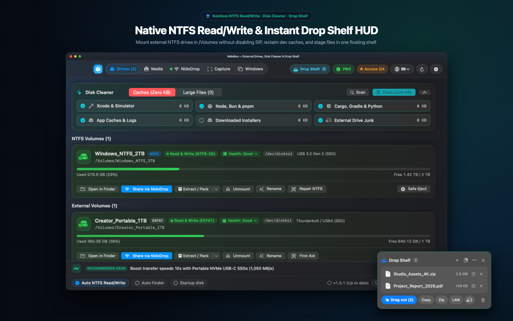

<p align="center">
  
</p>

<p align="center">
  <a href="../README.md">English</a> · <a href="README.vi.md">Tiếng Việt</a> · <a href="README.ja.md">日本語</a> · <a href="README.ko.md">한국어</a> · <a href="README.zh.md">简体中文</a> · <a href="README.th.md">ไทย</a> · <a href="README.id.md">Indonesia</a> · <a href="README.de.md">Deutsch</a> · <strong>Español</strong> · <a href="README.it.md">Italiano</a> · <a href="README.pt.md">Português</a>
</p>

# NidoBox — Lectura/Escritura NTFS, NidoDrop LAN y Suite Nativa (macOS & Windows)

[](https://github.com/stevedat/nidobox-releases/releases/latest)
[](https://github.com/stevedat/nidobox-releases/releases/latest)
[](https://github.com/stevedat/nidobox-releases/releases/latest)
[](https://github.com/stevedat/nidobox-releases/releases/latest)
[](https://tools.nido-holdings.com)

**NidoBox** es una suite nativa para **macOS 13.0+** (SwiftUI) y **Windows 10/11** (Rust + Tauri 2.0 + WebGPU) distribuida en paquetes dedicados por arquitectura.

## Descargas

| Plataforma y Chip | Instalador (`v1.5.1`) | Funciones Incluidas |
| :--- | :--- | :--- |
| **macOS Apple Silicon (`arm64`)** · M1–M4 | [**NidoBox-mac-arm64.dmg**](https://github.com/stevedat/nidobox-releases/releases/latest/download/NidoBox-mac-arm64.dmg) | Mac Suite Completa: NTFS L/E, NidoDrop LAN, Archivos, Limpiador, Media, Captura + OCR, Snap (`10.5 MB`) |
| **macOS Intel (`x86_64`)** | [**NidoBox-mac-x64.dmg**](https://github.com/stevedat/nidobox-releases/releases/latest/download/NidoBox-mac-x64.dmg) | Mac Edición Base: NTFS L/E, S.M.A.R.T., NidoDrop LAN (`9.4 MB`) |
| **Windows 10/11 x64 (`x86_64`)** · Intel & AMD | [**NidoBox-win-x64.exe**](https://github.com/stevedat/nidobox-releases/releases/latest/download/NidoBox-win-x64.exe) | Windows x64 Nativo: Capture Studio (WebGPU + OCR), NidoDrop LAN, Conversor de Imágenes, Archivos, Inicio Automático (`3.1 MB`) |
| **Windows 11 ARM64 (`aarch64`)** · Snapdragon X | [**NidoBox-win-arm64.exe**](https://github.com/stevedat/nidobox-releases/releases/latest/download/NidoBox-win-arm64.exe) | Windows ARM64 Nativo (Snapdragon X / Copilot+): Suite Windows completa sin emulación (`2.8 MB`) |
| **Linux x86_64 (`amd64`)** · Debian/Ubuntu/Fedora/Arch | [**.deb**](https://github.com/stevedat/nidobox-releases/releases/latest/download/nidobox_1.5.1_amd64.deb) · [**.rpm**](https://github.com/stevedat/nidobox-releases/releases/latest/download/nidobox-1.5.1-1.x86_64.rpm) · [**.pkg.tar.zst**](https://github.com/stevedat/nidobox-releases/releases/latest/download/nidobox-1.5.1-1-x86_64.pkg.tar.zst) · [**.tar.gz**](https://github.com/stevedat/nidobox-releases/releases/latest/download/nidobox-1.5.1-linux-x86_64.tar.gz) | Linux x86_64 (Debian/Ubuntu, Fedora/openSUSE, Arch, Portable): GTK4 + Static Rust, NidoDrop Live View & Touch-back, NidoKVM (Wayland/X11), Capture + OCR, NidoImage, NidoArchive, NTFS Repair |
| **Linux ARM64 (`aarch64`)** · Ubuntu-Nido/RPi/ARM | [**.deb**](https://github.com/stevedat/nidobox-releases/releases/latest/download/nidobox_1.5.1_arm64.deb) · [**.rpm**](https://github.com/stevedat/nidobox-releases/releases/latest/download/nidobox-1.5.1-1.aarch64.rpm) · [**.pkg.tar.zst**](https://github.com/stevedat/nidobox-releases/releases/latest/download/nidobox-1.5.1-1-aarch64.pkg.tar.zst) · [**.tar.gz**](https://github.com/stevedat/nidobox-releases/releases/latest/download/nidobox-1.5.1-linux-aarch64.tar.gz) | Linux ARM64 (Apple VM, Raspberry Pi, ARM Laptops): Native aarch64 static Rust + GTK4 suite |

### Linux APT Repository (Debian 12+ / Ubuntu 22.04+ / 24.04+ · `amd64` & `arm64`)

```bash
sudo install -d -m 0755 /etc/apt/keyrings
curl -fsSL https://ubuntu-nido-apt.pages.dev/ubuntu-nido.asc | sudo tee /etc/apt/keyrings/ubuntu-nido.asc >/dev/null
echo "deb [signed-by=/etc/apt/keyrings/ubuntu-nido.asc] https://ubuntu-nido-apt.pages.dev noble main" | sudo tee /etc/apt/sources.list.d/nidobox.list >/dev/null
sudo apt update && sudo apt install -y nidobox
```

## Capacidades Clave

- **NTFS Lectura/Escritura sin Kext (`macOS arm64 & x86_64`):** Montaje en `/Volumes` sin desactivar SIP y estado S.M.A.R.T.
- **NidoDrop LAN de Alta Velocidad (`macOS & Windows`):** Transferencia Wi-Fi local de archivos y portapapeles con QR + PIN de 4 dígitos.
- **Mac Suite Studio (`macOS arm64`):** Compresión, Limpiador, Conversor Multimedia, Captura + OCR bajo demanda, Quick Record Studio y Window Snap.
- **Edición Nativa Windows (`win-x64 & win-arm64`):** Ligera (~3 MB) con Rust + WebGPU, notas Callout curvas, Auto-Shield sensible, OCR bajo demanda, conversión por lotes y bandeja del sistema.

## Interfaz

| NTFS Read/Write & Drop Shelf HUD | NidoDrop LAN QR Transfer |
| :---: | :---: |
|  |  |
| **Smart Screenshot Markup & Auto-Shield** | **Quick Record Studio & Video Trimmer** |
|  |  |
| **Auto-Updater & System Settings** | **Batch Media, Archive & Companion Apps** |
|  |  |

## Arquitectura

<p align="center">
  
</p>

## Verificación SHA-256

```bash
# macOS / Linux
shasum -a 256 -c SHA256SUMS.txt
# Windows PowerShell
Get-FileHash .\NidoBox-win-*.exe -Algorithm SHA256
```
