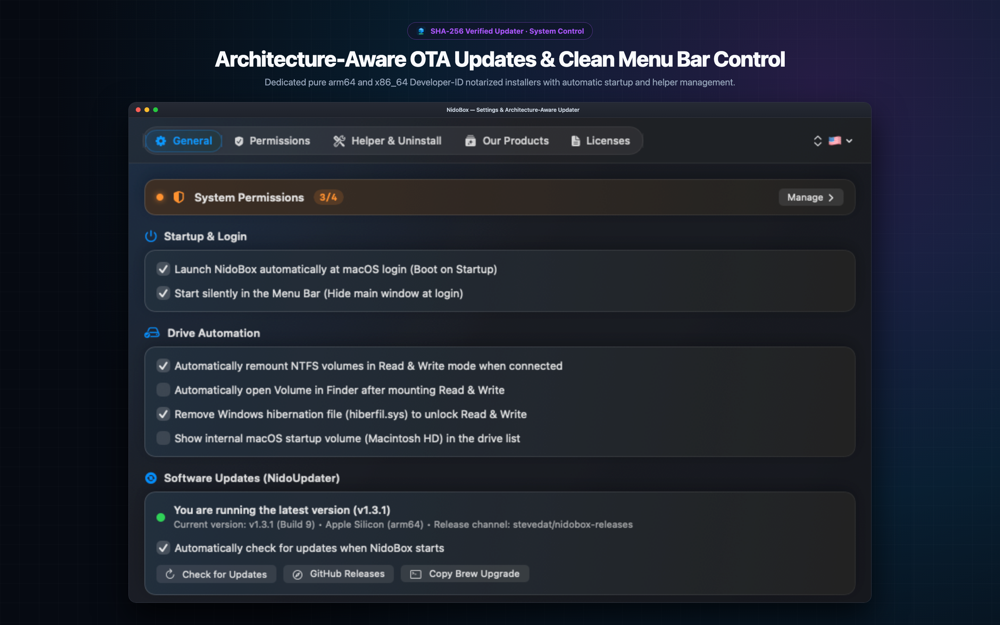
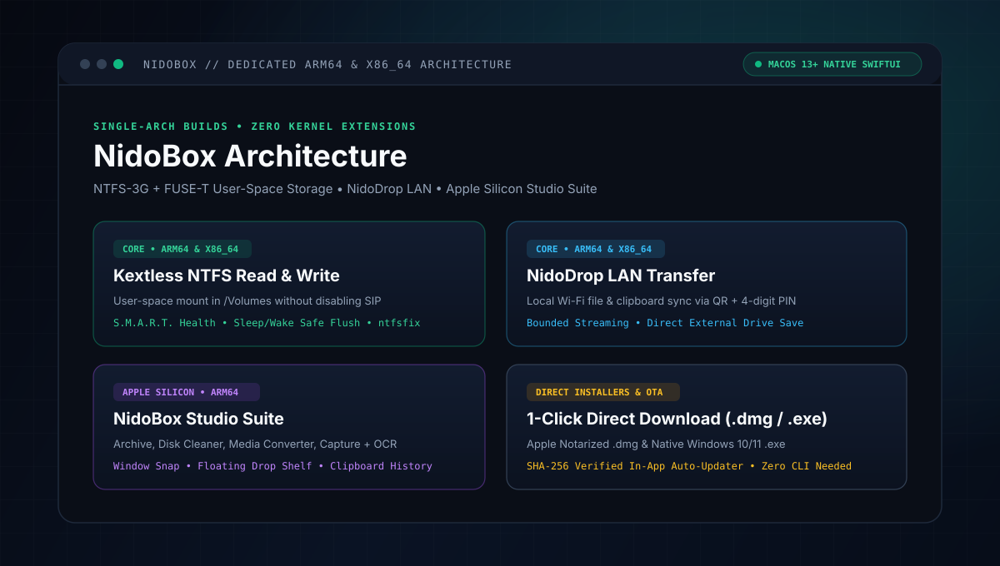

<p align="center">
  
</p>

<p align="center">
  <a href="../README.md">English</a> · <a href="README.vi.md">Tiếng Việt</a> · <a href="README.ja.md">日本語</a> · <a href="README.ko.md">한국어</a> · <a href="README.zh.md">简体中文</a> · <a href="README.th.md">ไทย</a> · <strong>Indonesia</strong> · <a href="README.de.md">Deutsch</a> · <a href="README.es.md">Español</a> · <a href="README.it.md">Italiano</a> · <a href="README.pt.md">Português</a>
</p>

# NidoBox — Baca/Tulis NTFS, NidoDrop LAN & Suite Utilitas Native (macOS & Windows)

[](https://github.com/stevedat/nidobox-releases/releases/latest)
[](https://github.com/stevedat/nidobox-releases/releases/latest)
[](https://github.com/stevedat/nidobox-releases/releases/latest)
[](https://github.com/stevedat/nidobox-releases/releases/latest)
[](https://tools.nido-holdings.com)

**NidoBox** adalah suite utilitas desktop native untuk **macOS 13.0+** (SwiftUI) dan **Windows 10/11** (Rust + Tauri 2.0 + WebGPU) dengan paket terpisah khusus tiap arsitektur.

## Unduhan

| Platform & Arsitektur | Penginstal (`v1.4.1`) | Fitur |
| :--- | :--- | :--- |
| **macOS Apple Silicon (`arm64`)** · M1–M4 | [**NidoBox-mac-arm64.dmg**](https://github.com/stevedat/nidobox-releases/releases/latest/download/NidoBox-mac-arm64.dmg) | Mac Suite Lengkap: NTFS R/W, NidoDrop LAN, Arsip, Cleaner, Media, Capture + OCR, Snap (`10.2 MB`) |
| **macOS Intel (`x86_64`)** | [**NidoBox-mac-x64.dmg**](https://github.com/stevedat/nidobox-releases/releases/latest/download/NidoBox-mac-x64.dmg) | Mac Edisi Inti: NTFS R/W, S.M.A.R.T., NidoDrop LAN (`9.4 MB`) |
| **Windows 10/11 x64 (`x86_64`)** · Intel & AMD | [**NidoBox-win-x64.exe**](https://github.com/stevedat/nidobox-releases/releases/latest/download/NidoBox-win-x64.exe) | Windows x64 Native: Capture Studio (WebGPU + OCR), NidoDrop LAN, Konversi Gambar Massal, Arsip, Auto-Startup (`3.0 MB`) |
| **Windows 11 ARM64 (`aarch64`)** · Snapdragon X | [**NidoBox-win-arm64.exe**](https://github.com/stevedat/nidobox-releases/releases/latest/download/NidoBox-win-arm64.exe) | Windows ARM64 Native (Snapdragon X / Copilot+): Suite Lengkap Windows ARM64 (`2.7 MB`) |
| **Linux x86_64 (`amd64`)** · Debian/Ubuntu/Fedora/Arch | [**.deb**](https://github.com/stevedat/nidobox-releases/releases/latest/download/nidobox_1.4.7_amd64.deb) · [**.rpm**](https://github.com/stevedat/nidobox-releases/releases/latest/download/nidobox-1.4.7-1.x86_64.rpm) · [**.pkg.tar.zst**](https://github.com/stevedat/nidobox-releases/releases/latest/download/nidobox-1.4.7-1-x86_64.pkg.tar.zst) · [**.tar.gz**](https://github.com/stevedat/nidobox-releases/releases/latest/download/nidobox-1.4.7-linux-x86_64.tar.gz) | Linux x86_64 (Debian/Ubuntu, Fedora/openSUSE, Arch, Portable): GTK4 + Static Rust, Capture + Callouts + OCR, NidoDrop LAN, NidoImage, NidoArchive, 1-click NTFS Repair |
| **Linux ARM64 (`aarch64`)** · Ubuntu-Nido/RPi/ARM | [**.deb**](https://github.com/stevedat/nidobox-releases/releases/latest/download/nidobox_1.4.7_arm64.deb) · [**.rpm**](https://github.com/stevedat/nidobox-releases/releases/latest/download/nidobox-1.4.7-1.aarch64.rpm) · [**.pkg.tar.zst**](https://github.com/stevedat/nidobox-releases/releases/latest/download/nidobox-1.4.7-1-aarch64.pkg.tar.zst) · [**.tar.gz**](https://github.com/stevedat/nidobox-releases/releases/latest/download/nidobox-1.4.7-linux-aarch64.tar.gz) | Linux ARM64 (Apple VM, Raspberry Pi, ARM Laptops): Native aarch64 static Rust + GTK4 suite |

### Linux APT Repository (Debian 12+ / Ubuntu 22.04+ / 24.04+ · `amd64` & `arm64`)

```bash
sudo install -d -m 0755 /etc/apt/keyrings
curl -fsSL https://ubuntu-nido-apt.pages.dev/ubuntu-nido.asc | sudo tee /etc/apt/keyrings/ubuntu-nido.asc >/dev/null
echo "deb [signed-by=/etc/apt/keyrings/ubuntu-nido.asc] https://ubuntu-nido-apt.pages.dev noble main" | sudo tee /etc/apt/sources.list.d/nidobox.list >/dev/null
sudo apt update && sudo apt install -y nidobox
```

## Fitur Inti

- **NTFS Baca/Tulis Tanpa Kext (`macOS arm64 & x86_64`):** Mount di `/Volumes` tanpa mematikan SIP serta pantau kesehatan S.M.A.R.T.
- **NidoDrop LAN Cepat (`macOS & Windows`):** Transfer file & clipboard via Wi-Fi lokal dengan QR + PIN 4 digit.
- **Mac Studio Suite (`macOS arm64`):** Arsip, Disk Cleaner, Konverter Media, Capture + OCR sesuai permintaan, Quick Record Studio, Window Snap.
- **Windows Native Edition (`win-x64 & win-arm64`):** Penginstal ringan ~3 MB berbasis Rust + WebGPU dengan Capture Studio, catatan Callout lengkung, Auto-Shield, OCR, konversi gambar paralel, dan tray startup.

## Antarmuka

| NTFS Read/Write & Drop Shelf HUD | NidoDrop LAN QR Transfer |
| :---: | :---: |
|  |  |
| **Smart Screenshot Markup & Auto-Shield** | **Quick Record Studio & Video Trimmer** |
|  |  |
| **Auto-Updater & System Settings** | **Batch Media, Archive & Companion Apps** |
|  |  |

## Arsitektur

<p align="center">
  
</p>

## Verifikasi SHA-256

```bash
# macOS / Linux
shasum -a 256 -c SHA256SUMS.txt
# Windows PowerShell
Get-FileHash .\NidoBox-win-*.exe -Algorithm SHA256
```
