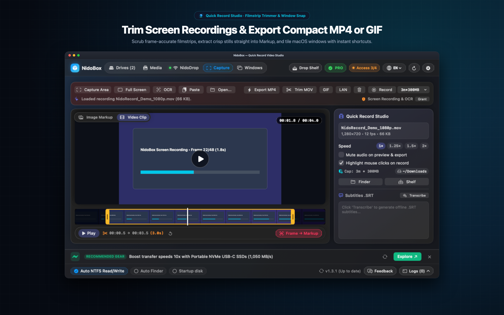

<p align="center">
  
</p>

<p align="center">
  <a href="../README.md">English</a> · <strong>Tiếng Việt</strong> · <a href="README.ja.md">日本語</a> · <a href="README.ko.md">한국어</a> · <a href="README.zh.md">简体中文</a> · <a href="README.th.md">ไทย</a> · <a href="README.id.md">Indonesia</a> · <a href="README.de.md">Deutsch</a> · <a href="README.es.md">Español</a> · <a href="README.it.md">Italiano</a> · <a href="README.pt.md">Português</a>
</p>

# NidoBox — Đọc/Ghi NTFS, NidoDrop LAN & Bộ Tiện Ích Nguyên Bản (macOS, Windows & Linux)

[](https://github.com/stevedat/nidobox-releases/releases/latest)
[](https://github.com/stevedat/nidobox-releases/releases/latest)
[](https://github.com/stevedat/nidobox-releases/releases/latest)
[](https://github.com/stevedat/nidobox-releases/releases/latest)
[](https://tools.nido-holdings.com)

**NidoBox** là bộ tiện ích nguyên bản cho **macOS 13.0+** (SwiftUI), **Windows 10/11** (Rust + Tauri 2.0 + WebGPU) và **Linux** (GTK4/Libadwaita + Rust musl tĩnh), đóng gói riêng từng kiến trúc chip, không qua lớp giả lập.

## Tải Bộ Cài

| Hệ điều hành & Chip | Bộ cài (`v1.5.1`) | Tính năng bao gồm |
| :--- | :--- | :--- |
| **macOS Apple Silicon (`arm64`)** · M1–M4 | [**NidoBox-mac-arm64.dmg**](https://github.com/stevedat/nidobox-releases/releases/latest/download/NidoBox-mac-arm64.dmg) | Bản Mac đầy đủ: NTFS R/W, NidoDrop LAN + Live View/Touch-back, NidoKVM, Giải nén, Dọn đĩa, Media, Chụp + OCR, Quay màn hình, Cửa sổ, Khay tạm (`10.5 MB`) |
| **macOS Intel (`x86_64`)** | [**NidoBox-mac-x64.dmg**](https://github.com/stevedat/nidobox-releases/releases/latest/download/NidoBox-mac-x64.dmg) | Bản Mac cốt lõi: NTFS R/W, S.M.A.R.T., NidoDrop LAN (`9.4 MB`) |
| **Windows 10/11 x64 (`x86_64`)** · Intel & AMD | [**NidoBox-win-x64.exe**](https://github.com/stevedat/nidobox-releases/releases/latest/download/NidoBox-win-x64.exe) | Bản Windows x64 Native: NidoDrop Live View/Touch-back, NidoKVM, Capture Studio (WebGPU + OCR), Đổi ảnh, Giải nén, Chạy nền siêu nhẹ (`3.1 MB`) |
| **Windows 11 ARM64 (`aarch64`)** · Snapdragon X | [**NidoBox-win-arm64.exe**](https://github.com/stevedat/nidobox-releases/releases/latest/download/NidoBox-win-arm64.exe) | Bản Windows ARM64 Native (Snapdragon X / Copilot+): Trọn bộ tính năng Windows nguyên bản (`2.8 MB`) |
| **Linux x86_64 (`amd64`)** · Debian/Ubuntu/Fedora/Arch | [**.deb**](https://github.com/stevedat/nidobox-releases/releases/latest/download/nidobox_1.5.1_amd64.deb) · [**.rpm**](https://github.com/stevedat/nidobox-releases/releases/latest/download/nidobox-1.5.1-1.x86_64.rpm) · [**.pkg.tar.zst**](https://github.com/stevedat/nidobox-releases/releases/latest/download/nidobox-1.5.1-1-x86_64.pkg.tar.zst) · [**.tar.gz**](https://github.com/stevedat/nidobox-releases/releases/latest/download/nidobox-1.5.1-linux-x86_64.tar.gz) | Linux x86_64 (Debian/Ubuntu, Fedora/openSUSE, Arch, Portable): GTK4 + Rust tĩnh, NidoDrop Live View/Touch-back, NidoKVM (Wayland/X11), Capture + OCR, Đổi ảnh, Giải nén, Cứu hộ NTFS |
| **Linux ARM64 (`aarch64`)** · Ubuntu-Nido/RPi/ARM | [**.deb**](https://github.com/stevedat/nidobox-releases/releases/latest/download/nidobox_1.5.1_arm64.deb) · [**.rpm**](https://github.com/stevedat/nidobox-releases/releases/latest/download/nidobox-1.5.1-1.aarch64.rpm) · [**.pkg.tar.zst**](https://github.com/stevedat/nidobox-releases/releases/latest/download/nidobox-1.5.1-1-aarch64.pkg.tar.zst) · [**.tar.gz**](https://github.com/stevedat/nidobox-releases/releases/latest/download/nidobox-1.5.1-linux-aarch64.tar.gz) | Linux ARM64 (VM trên Apple Silicon, Raspberry Pi, Laptop ARM): Trọn bộ Linux nguyên bản aarch64 |

### Linux APT Repository (Debian 12+ / Ubuntu 22.04+ / 24.04+ · `amd64` & `arm64`)

```bash
sudo install -d -m 0755 /etc/apt/keyrings
curl -fsSL https://ubuntu-nido-apt.pages.dev/ubuntu-nido.asc | sudo tee /etc/apt/keyrings/ubuntu-nido.asc >/dev/null
echo "deb [signed-by=/etc/apt/keyrings/ubuntu-nido.asc] https://ubuntu-nido-apt.pages.dev noble main" | sudo tee /etc/apt/sources.list.d/nidobox.list >/dev/null
sudo apt update && sudo apt install -y nidobox
```

## Tính Năng Chính

- **Đọc/Ghi NTFS Không Kext (`macOS arm64 & x86_64`):** Mount trực tiếp vào `/Volumes` qua `NTFS-3G` + `FUSE-T` không cần tắt SIP, theo dõi S.M.A.R.T. và tự `sync` trước khi ngủ.
- **NidoDrop LAN + Live View & Touch-back (`macOS, Windows & Linux`):** Truyền tệp lớn & Clipboard qua Wi-Fi bằng mã QR + PIN 4 số, trình chiếu ảnh (Image Stage), chiếu màn hình (Screen Cast / Màn hình ảo trên Apple Silicon) và chạm điều khiển ngược từ điện thoại/tablet qua Web Receiver thống nhất.
- **NidoKVM Đa Nền Tảng (`macOS arm64, Windows & Linux`):** Chia sẻ chuột, bàn phím và clipboard mượt qua LAN giữa macOS, Windows và Linux (Wayland & X11), hỗ trợ chuyển cạnh màn hình, PIN 4 số và đổi phím `Cmd ↔ Ctrl` thông minh.
- **Bộ Công Cụ Mac Studio (`macOS arm64`):** Giải nén/Nén (`.zip`/`.7z`/`.rar`/`.iso`), Dọn ổ đĩa, Chuyển đổi Media, Chụp thông minh (Tiêu điểm, Che mờ, Ghi chú ghim cong, Tự che AI, OCR theo yêu cầu), Biên tập nhanh bản ghi video, Chia cửa sổ và Khay tạm.
- **Windows & Linux Native (`x64 & ARM64`) + Tối Ưu RAM Siêu Nhẹ:** Bộ cài ~3 MB trên Windows và gói đa distro trên Linux với cơ chế tối ưu bộ nhớ kiểu Kiri: hủy hẳn WebView2 khi đóng xuống Tray (~0 MB RAM UI), nén lịch sử Undo Capture Studio, tự ngủ xả buffer sau 60s rảnh và điều tiết luồng đổi ảnh theo RAM máy.

## Giao Diện

| NTFS Read/Write & Drop Shelf HUD | NidoDrop LAN QR Transfer |
| :---: | :---: |
|  |  |
| **Smart Screenshot Markup & Auto-Shield** | **Quick Record Studio & Video Trimmer** |
|  |  |
| **Auto-Updater & System Settings** | **Batch Media, Archive & Companion Apps** |
|  |  |

## Kiến Trúc

<p align="center">
  
</p>

## Kiểm Chứng SHA-256

```bash
# macOS / Linux
shasum -a 256 -c SHA256SUMS.txt
# Windows PowerShell
Get-FileHash .\NidoBox-win-*.exe -Algorithm SHA256
```
